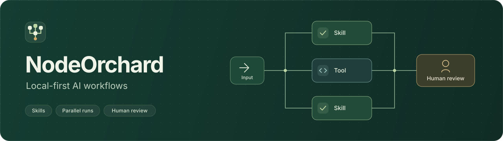
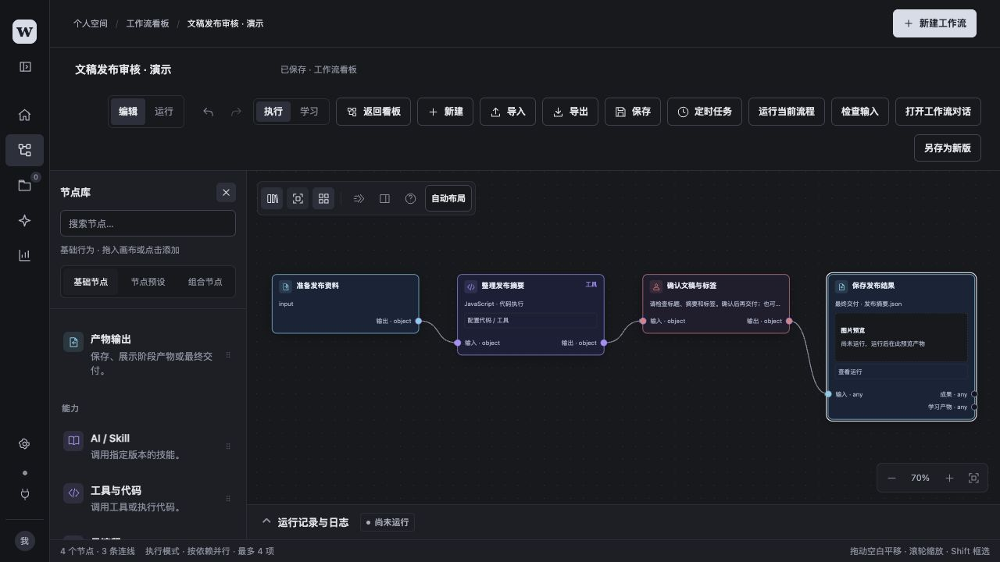
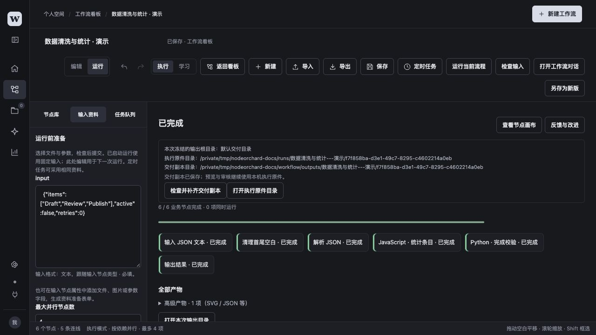
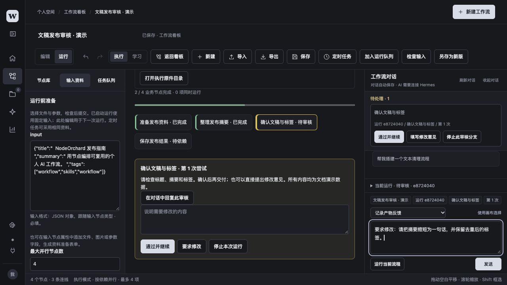
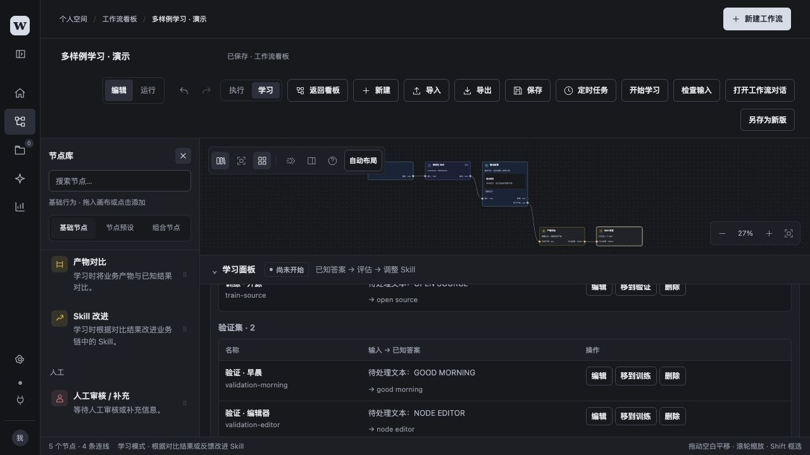
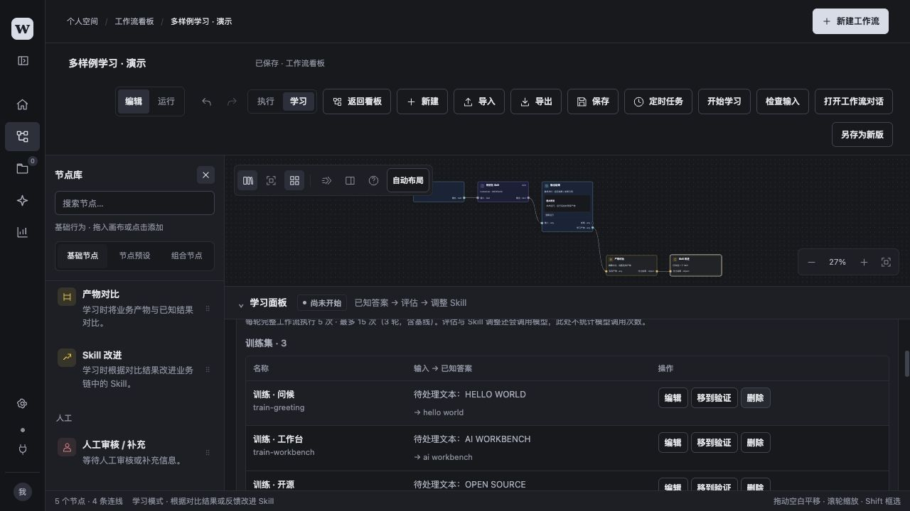
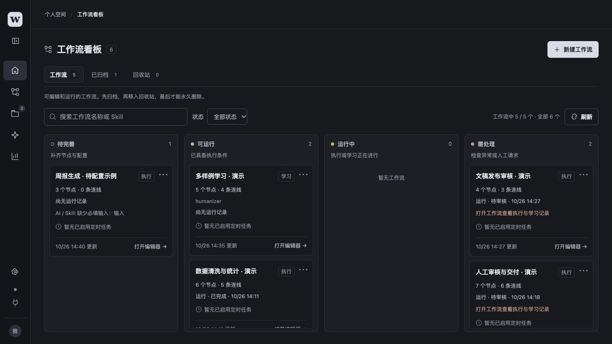
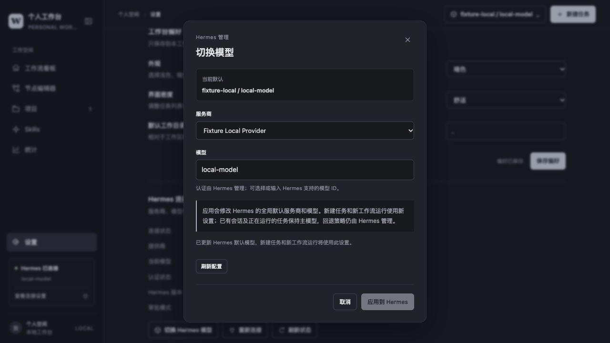
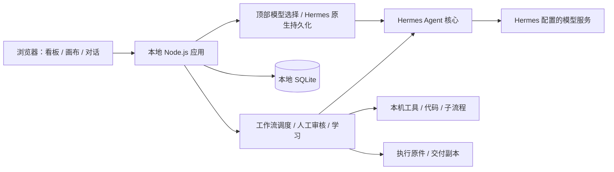

<div align="center">
  
  <h1>NodeOrchard</h1>
  <p><strong>让能力成为节点，让工作流持续生长。</strong></p>
  <p>Local-first AI workflows with Skills, parallel execution, and human review.</p>
  <p>
    <a href="https://nodejs.org/en/download"></a>
    
    <a href="https://github.com/NousResearch/hermes-agent"></a>
  </p>
  <p>
    <a href="#界面预览">界面预览</a> ·
    <a href="#快速开始">快速开始</a> ·
    <a href="#连接-hermes-与切换模型">模型管理</a> ·
    <a href="#配置与本地数据">配置</a> ·
    <a href="#文档与示例">文档</a>
  </p>
</div>



NodeOrchard 是面向个人的本地 AI 工作流应用。通过节点画布或 AI 对话，将小型 Skill、本机工具、代码和子流程组织为可执行流程；在需要判断的地方等待人工审核，在需要改进的地方保留反馈和版本。

应用负责编辑、调度、产物与审核，**Hermes 是 Agent 核心**，负责工具调用、Skills、记忆、模型连接与认证。工作台读取 Hermes 的配置，并通过顶部入口选择服务商和模型；选择由 Hermes 校验和保存。普通工具与代码流程可以独立运行，无需连接模型。

> 当前定位：本机、单用户、自行部署。主应用不依赖前端构建服务或独立数据库；HDK 工程能力是可选的本机专业集成，需要另行准备依赖。

> **安装前提：使用 Skill、AI 对话与学习功能前，请先安装 Hermes Agent，配置模型服务商并验证 Hermes 能正常对话。** 按[快速开始](#快速开始)准备 Hermes，再启动 NodeOrchard。

## 可以做什么

| 能力 | 当前行为 |
| --- | --- |
| 节点编排 | 拖拽、具名端口连线、属性配置、撤销／重做、导入／导出；画布平移和缩放不自动保存，重开适应画布；支持深浅主题 |
| 工作流文件夹 | 每条流程独立存放定义、完整聊天 JSON／Markdown、可恢复上下文、素材和运行文件；以 `.workflow` ZIP 包导入为新副本继续对话 |
| 基础节点 | 输入与校验、Skill、工具／代码、子流程、数据整理、控制、人工审核、产物输出与学习支线 |
| 依赖调度 | DAG 独立分支并行，按依赖汇合；多个运行排队，并受资源和并发限额约束 |
| AI 对话 | 统一描述任务、配置固定需求、运行和反馈；自动判断意图，修改提案经审阅应用，旧问答可折叠 |
| Skill 图片与软件工具 | 人工新建 Skill；复用 Hermes 图像提供商，真实图片登记后审核交付；浏览器、Computer Use 和已配置 MCP 显示真实就绪状态 |
| 聊天素材 | 在输入框粘贴图片／文件、拖放或选择文件；素材归属当前工作流，可供 AI 查看或准备输入草稿，详见[聊天素材](workbench/docs/workflow-packages.md#聊天素材) |
| 对话管理 | 每条工作流独立会话；总控按问题新建主题，按需检查会话和委派只读诊断，现有记录保留 |
| 快捷键 | 对话默认 Ctrl+Enter / ⌘+Enter 发送；设置页可录制、禁用、恢复和保存快捷键，检查生效范围与冲突 |
| 模型管理 | 顶部切换 Hermes 已配置的服务商和模型；默认选择保存在 Hermes，新任务与新运行采用新设置 |
| 人工审核 | 图片可在中途预览并阻塞下游；人工要求修改不限次数；Skill 接收反馈重做，工具产物一键提交 AI 重生核心代码候选，确认应用后新建运行 |
| 运行观察 | 逐节点输入、输出、状态、日志与历史尝试；修改草稿不改写已有运行 |
| 产物交付 | 阶段输出与最终输出；执行原件和交付副本分离，副本可单独重试保存 |
| 执行与学习 | 执行固定版本；学习可改进选定 Skill、指定工具或内部业务流程，记录逐例评估和候选差异，最佳版本经用户应用到草稿 |
| 定时任务 | 指定时间运行一次，或按时区每日运行；与手动执行共用输入预检 |
| 工作流管理 | 看板、搜索、另存新版、回收站；移入回收站后卸载当前编辑器，恢复后明确打开才加载 |

学习不是自动获得通用能力的保证。训练集与验证集用于评估和候选选择，仍需独立样例及人工复评；执行允许 Hermes 更新长期记忆，学习批次使用固定的只读记忆快照，避免本批样例写回共享记忆。

所有工具节点的产物反馈均由 AI 重生核心业务代码候选，即使下游连接 Skill 也走此路径。填写意见并单击“生成修改候选”，即提交同一对话并启动 AI 分类，无需再次发送；版本与权限绑定有效时，分类为 `workflow` 或 `feedback` 均可生成显式候选，保留 AI 原始分类。候选必须包含实际业务代码变化，审阅并应用到草稿后，需明确发起新运行。人工修改不限次数，自动重试保留独立限制。原运行的代码、审核与产物继续保留。其它意图边界见[审核、重做与反馈](workbench/docs/workflow-conversation.md#审核重做与反馈)。

节点编辑器只加载活动工作流。当前工作流移入回收站或永久删除后，页面显示空态，保留本地草稿、历史与产物；旧归档链接和上次选中缓存也不会加载回收站记录。恢复只更新工作流库，用户明确打开后才加载。详见[回收站与删除](workbench/docs/workflow-lifecycle.md)。

固定任务可以在右侧对话中配置一次默认输入，例如“每次获取今日 GitHub 热榜并导出 Excel，无需重复填写需求”。应用修改后，直接点击运行或在对话中发送“运行”即可；只有没有默认值的必需资料才需要补充。运行结果和反馈沿用同一对话，原有范围选择保留在高级选项。隐藏画布时，节点库、节点属性与画布工具同时隐藏，重新打开恢复原布局。

待处理区可整组折叠，也可用“×”本地隐藏整组或单项提示，通过“显示已隐藏 · N”恢复；新事项或新审核版本会重新提示。隐藏不处理审核或改变运行，已确认处理的聊天事项仍按原规则退出列表，历史保留。详见 [待处理事项](workbench/docs/workflow-conversation.md#待处理事项)。

“对话管理”集中展示工作流会话与总控主题。工作流继续使用各自的聊天记录；总控主题分别保存上下文，按需读取目标会话，不把所有历史合并成一条长对话。旧全局聊天作为历史入口保留，原“项目”页中的普通任务仍可通过历史任务入口查看。

工作流有改动时默认每 10 分钟保存一次，可在“设置 → 工作台偏好”调整周期或关闭；编辑器中 `Ctrl+S`／`⌘S` 和保存按钮立即保存。切换页面或关闭时保留本地恢复草稿，不额外提交版本。对话、运行及审核记录仍即时保存，导出等明确操作继续保存必要快照。

模型对话默认持续等待 Hermes 或模型服务返回结果／错误，可随时手动停止；工作台不再使用首响应、输出空闲或整轮计时器提前截断。外部工具及工作流节点自身的执行时限仍按原配置。

Skills 页区分 Hermes 自带、工作台内置和后续创建的技能。内置技能只读；具备可信生成回执的技能可删除，在用引用会阻止删除，历史及冻结副本保留。来源未确认的旧技能保持保护，详见[来源与删除](workbench/docs/skill-integrations.md#来源与删除)。

总控可读取新采集的请求链路元数据；“设置 → 助手权限 → 总控助手”提供独立的“读取工作台源码”和“模型诊断实验”开关，默认关闭。模型实验只发送按历史规模生成的合成文本，输入上限可调，每轮一次；有真实模型消耗，输出长度为软约束，不修改或运行已有工作流。压缩SSE类型在SDK解码后计数；缺少响应类型头时按完整帧有界识别，保持头部格式未知。已确认的诊断意图自动加载诊断Skill，持续取证时复用有效短探测。源码支持文字定位和可续读短页，保留行号、SHA及实际截断状态。

总控提供默认关闭的实验性源码自修复。用户在设置中手动开启后，可修改允许的工作台源码、运行隔离相关测试并保留回滚记录；不修改或重跑真实工作流。前端需刷新、后端由用户手动重启，边界与操作见[总控源码自修复](workbench/docs/application-source-repair.md)。

## 界面预览

以下均为在隔离环境中新建的通用演示工作流，通过软件界面操作并截图；不包含私人工作流、业务输入、私人训练答案或业务验收记录。

### 节点编辑器

节点库、分类配色、画布与属性栏共用一套界面；关键产物和审核节点可显示预览。



### 执行过程

六节点本地流程真实运行完成，展示节点状态、示例输入和交付位置；各节点实际输入／输出可在运行详情中展开。此示例不调用模型。



### 人工审核

整理文稿后等待人工决定，相关下游保持阻塞；对话框中的修改意见为尚未发送的演示草稿。



### 多样例学习配置

配置训练集、验证集、评价标准与学习范围，可选择 Skill、指定工具或整个工作流。下面演示使用 Skill 范围，包含 3 条训练样例和 2 条验证样例；截图仅展示配置，不代表学习成绩。各范围及本地代码边界见[学习协议](workbench/docs/learning-protocol.md#学习范围与候选校验)。



<details>
<summary>查看训练样例编辑区</summary>



</details>

### 独立工作流看板

按配置和真实运行状态组织流程，并集中呈现需要处理的事项。



### 顶部模型切换

直接读取和切换 Hermes 的默认服务商与模型。下图来自独立协议演示后端，服务商和模型名称均为测试数据；真实使用时展示本机 Hermes 的配置。



## 快速开始

### 1. 准备 Node.js

需要 **Node.js ≥ 22.13**，推荐 Node.js 24。请从 [Node.js 官方下载页](https://nodejs.org/en/download)安装，并确认当前终端使用的版本：

```sh
node --version
npm --version
```

主应用使用 Node 内置模块，包括 SQLite。没有 npm 运行依赖，**无需执行 `npm install`**。

### 2. 提前安装并配置 Hermes

Hermes 是独立运行时，需要**先安装到本机**。请按 [Hermes 官方快速开始](https://hermes-agent.nousresearch.com/docs/getting-started/quickstart)完成安装。macOS／Linux／WSL2 可使用官方命令行安装脚本：

```sh
curl -fsSL https://hermes-agent.nousresearch.com/install.sh | bash
```

Windows 原生安装及其它方式见上述官方指南。安装后重新打开终端，再配置模型并验证对话：

```sh
hermes --version
hermes model
hermes
```

在 `hermes model` 中选择你使用的服务商并完成认证，然后在 `hermes` 中发送一条测试消息，确认能正常回复。使用现有 ChatGPT 订阅时，可在 Hermes 向导选择 **ChatGPT or Codex Subscription**；也可使用 Hermes 支持并已配置的其他服务商。

**当前适配验证版本为 Hermes 0.21.4**。安装后核对版本；其他版本需要确认桥接接口兼容。NodeOrchard 与 Hermes 应位于同一运行环境：例如 Hermes 安装在 WSL2 时，也在该 WSL2 环境运行 NodeOrchard。Hermes 的安装位置与 Python 环境需能由本应用访问，自定义路径见[连接说明](#连接-hermes-与切换模型)。

### 3. 获取源码并启动

```sh
git clone https://github.com/geekheart/NodeOrchard.git
cd NodeOrchard
npm --prefix workbench start
```

打开 **[http://127.0.0.1:4318](http://127.0.0.1:4318)**。首次启动会自动创建根目录下的 `workflow/` 与本地状态目录。默认只监听 `127.0.0.1`。

服务在当前终端前台运行；保持终端开启，使用 `Ctrl+C` 停止。浏览器页面可以关闭，后台调度仍由该进程负责。当前没有开箱即用的系统自启动安装器。

### 4. 连接 Hermes 并选择模型

点击左侧 **“连接 Hermes”**，或从顶部模型入口连接。工作台会读取 Hermes 的当前服务商和模型目录。需要更换时，在顶部选择服务商、选择或输入模型 ID，点击 **“应用到 Hermes”**；在 Skills 页面确认能读取已安装技能。

新增服务商、登录或更新凭据先在 Hermes 中完成，再回到工作台点击“刷新配置”。选择会更新 Hermes 的全局默认模型；已有会话和运行中的工作流保持原主模型，新任务与新发起的运行使用新设置。

### 5. 先跑一个本地流程

1. 从看板新建空白工作流，在空画布点击“载入示例”。
2. 在“执行示例”选择“本地数据 · 工具与代码”，使用已填好的默认输入，切换运行视图后运行。
3. 在运行记录中查看各节点的输入、输出和日志。该示例只使用内置工具与 JavaScript，无需连接 Hermes 或配置 Python。
4. 另建空白工作流可体验“文稿发布 · 人工审核”：停在“确认文稿与标签”是正常等待，核对并通过后才保存结果。

示例分“执行”和“学习”两组，载入保留当前工作流 ID，不会自动执行。学习示例覆盖 Skill、指定工具和整个业务工作流，带完整支路、训练集、验证集与改进目标；模型、Skill 与权限条件见[载入示例](workbench/docs/user-guide.md#载入示例)。

纯本地工具和 JavaScript 节点无需 Hermes。Python 节点需要可用的 Python 解释器，可通过 `WORKBENCH_HERMES_PYTHON` 指定；调用外部命令的代码还需要对应本机工具。

## 连接 Hermes 与切换模型

先按[快速开始](#2-提前安装并配置-hermes)安装 Hermes、配置服务商并验证对话。Hermes 管理提供商、模型连接、凭据及回退策略；NodeOrchard 通过其原生接口使用 Agent 能力。ChatGPT 订阅的 `openai-codex` 是其中一种模型路由，使用它时 Agent 核心仍是 Hermes。模型可用性、费用和限制取决于你在 Hermes 中配置的服务商与账号。

桥接使用 Hermes 的 Agent、Skill、记忆及模型选择接口，对接口变化有显式检查；这不表示任意 Hermes 版本均兼容。升级 Hermes 前建议备份状态并验证连接。

macOS 下，每次启动 Hermes 子进程时，工作台会在没有显式代理环境变量的情况下继承系统静态 HTTP／HTTPS 代理；已有环境设置优先。只调整该子进程的环境，不修改系统或 Hermes 配置。支持范围及连接诊断见[代理继承](workbench/docs/hermes-protocol.md#代理继承)。

NodeOrchard 默认查找：

```text
Hermes 源码：~/.hermes/hermes-agent
Python：    ~/.hermes/hermes-agent/venv/bin/python
Hermes 状态：~/.hermes
```

若官方安装位置或虚拟环境名称不同，启动前显式设置实际路径。例如在 macOS／Linux 的 shell 中：

```sh
export WORKBENCH_HERMES_ROOT="$HOME/path/to/hermes-agent"
export WORKBENCH_HERMES_PYTHON="$WORKBENCH_HERMES_ROOT/.venv/bin/python"
npm --prefix workbench start
```

这里的 `.venv` 只是自定义安装示例，请以实际文件为准。然后点击应用左侧 **“连接 Hermes”**，在 Skills 页面确认能读取已安装技能；在 Skill 节点属性中选择真实技能并保存内容指纹。

顶部模型入口只列举 Hermes 返回的已配置服务商，并要求其认证状态已确认。模型目录提供候选，也可输入 Hermes 支持的模型 ID；应用先由 Hermes 校验、保存，再读回确认，失败时保留界面选择并显示错误。需要费用或数据策略确认的选择，按提示在 Hermes 原生界面完成后刷新。

主服务商和模型按**会话、工作流运行与学习批次**固定，覆盖后续节点、审核修订和子流程；Hermes 的回退策略继续由 Hermes 管理。旧记录优先从已保存的会话和运行恢复模型身份，无法确认时保留产物并明确拒绝续跑，避免悄悄使用新的默认模型。

工作台不再保存独立的默认模型覆盖；旧 `defaultModel` 偏好已停用。`WORKBENCH_HERMES_MODEL` 不再用于选择模型，模型与提供商的进程启动覆盖也不会传给本应用启动的 Hermes 子进程。请通过顶部入口或 `hermes model` 管理选择；外部修改后在顶部入口点击“刷新配置”。

## 配置与本地数据

默认工作环境位于仓库根目录的 **`workflow/`**，不存在时自动创建。新任务相对工作目录 `.` 直接表示这个根；用户显式设置的目录优先。

| 位置 | 用途 |
| --- | --- |
| `workflow/artifacts/` | 普通会话产物 |
| `workflow/workflows/<id>/` | 单个工作流的完整可携副本、输入、执行原件及默认交付；详见[工作流文件夹与便携包](workbench/docs/workflow-packages.md) |
| `workflow/outputs/` | 保留旧交付副本；流程仍可自定义交付位置 |
| `workflow/config/` | 本机资源位置与专业工具配置，按需创建 |
| `workflow/workflow-sessions/` | Skill 节点会话与本次冻结的能力副本 |
| `workbench/.local/` | SQLite、偏好、Skill 快照、缓存与本机依赖 |
| 本机应用数据目录中的 `runs/` | 保留旧执行原件、回执与节点历史版本 |

旧原件目录在 macOS 为 `~/Library/Application Support/PersonalAgentWorkbench/runs/`，Windows 使用 Local AppData，Linux 使用 XDG state；这些历史路径继续保留。新运行使用所属工作流目录，迁移与便携包规则见[工作流文件夹与便携包](workbench/docs/workflow-packages.md)。

预览、审核与节点交接绑定执行原件。交付只复制输出节点明确声明的成果；副本保存失败可单独重试，副本被删改可检查补齐，无需重新调用模型或重复人工审核。

### 环境变量

| 变量 | 默认值／说明 |
| --- | --- |
| `WORKBENCH_PORT` | `4318`；监听地址固定为本机回环地址 |
| `WORKBENCH_WORKSPACE_ROOT` | 项目根目录 `workflow/` |
| `WORKBENCH_DATA_DIR` | `workbench/.local/` |
| `WORKBENCH_RUN_ROOT` | 兼容旧原件根；新工作流运行使用自身文件夹 |
| `WORKBENCH_HERMES_ROOT` | `~/.hermes/hermes-agent` |
| `WORKBENCH_HERMES_PYTHON` | Hermes 安装内的 `venv/bin/python`，也用于 Python 代码节点 |
| `WORKBENCH_HERMES_HOME` | `~/.hermes` |

例如以独立状态和工作区启动测试实例：

```sh
WORKBENCH_PORT=4320 \
WORKBENCH_DATA_DIR="$PWD/workflow/demo-state" \
WORKBENCH_WORKSPACE_ROOT="$PWD/workflow/demo-workspace" \
npm --prefix workbench start
```

`WORKBENCH_WORKSPACE_ROOT` 决定工作流文件夹所在空间，`WORKBENCH_RUN_ROOT` 继续用于旧原件目录准入与兼容。环境变量须在服务启动前设置，应用不会自动加载 `.env` 文件。

### 定时运行与代码边界

- 定时任务需要服务持续运行、电脑保持唤醒；含 Skill 时还需要 Hermes 已连接、模型配置及对应认证可用。
- 关闭浏览器不影响定时任务。服务离线期间错过的触发不补跑；重启也不会自动重放结果未知的在途能力。
- 代码节点在本机独立进程运行，具备超时和停止机制，**不是操作系统沙箱**。请只运行信任的代码；停止不会撤销外部副作用。
- 当前服务用于本机个人使用；没有多人账号、远程访问控制或完整 Docker 部署方案。

## 架构与目录



```text
NodeOrchard/
├── workbench/
│   ├── src/                  应用装配、HTTP、配置、持久化与 Hermes 适配
│   │   └── workflows/        工作流调度、审核、对话、学习与文件管理
│   ├── shared/workflow/      前后端共用的纯模型、端口与协议
│   ├── public/               浏览器页面、画布与主题
│   ├── python/               Hermes 桥接与 Python 执行器
│   ├── skills/               人工维护的 Skill、源码模板与 schema
│   ├── hdk/                  可选工程能力、转换器适配与强校验
│   ├── examples/             可分享的通用流程与数据集
│   ├── test/                 自动化测试与脱敏 fixture
│   ├── scripts/              开发检查及工具
│   └── docs/                 完整操作与架构说明
├── docs/                     公开品牌资产与通用演示截图
├── workflow/                 本地工作环境，Git 忽略
├── AGENTS.md                 协作与模块边界
└── THIRD_PARTY_NOTICES.md     第三方代码及外部集成说明
```

依赖方向为界面／后端到共享模型。`shared/workflow/` 不依赖 DOM、文件系统、HTTP 或数据库；浏览器只通过静态资源白名单读取共享模块。详细设计见[整体架构](workbench/docs/architecture.md)。

### 可选 HDK 工程能力

仓库包含原生 EDA 导出、实拍 Pinout、接口标注、双语指南、工艺要求、固件编译和测试说明等集成。它们依赖本机资料与外部工具，**不属于基础启动流程**。

当前工程集成在 macOS 本机环境验证，涉及嘉立创 EDA 专业版、Chrome／Playwright、draw.io、外部转换器、Python 包及指定 SDK／编译器；部分渲染与文档脚本还存在 Codex runtime 和应用安装路径约束。不能直接视为跨平台的一键工程导出工具。

开始前阅读 [HDK 能力边界](workbench/hdk/ARCHITECTURE.md)、[四文件流程](workbench/docs/four-files-workflow.md)与[应用配置](workbench/README.md#配置)，准备自己的工程、照片、模板和资源覆盖配置。缺依赖时应补齐环境；固件编译成功仍不代表实板测试通过。

## 开发、测试与发布边界

```sh
npm --prefix workbench test
npm --prefix workbench run check:git
git diff --cached --stat
```

测试固定使用 `test/*.test.mjs`，Python 测试由包装器调用；不要用裸 `node --test` 自动发现，以免启动常驻 fixture。部分外部工具测试在依赖缺失时明确跳过，真实模型与硬件验收需单独执行。

`check:git` 检查已跟踪文件及未忽略的候选文件，包括个人主目录字面量和私有目录边界；它不修改暂存区、不上传文件。提交前仍需审阅实际暂存内容。

本地工作流、业务输入、训练答案、候选 Skill、学习记忆、运行快照和实际验证截图均不进入 Git。公开截图仅使用新建的通用演示；`shared/workflow/`、通用 `examples/` 和人工维护的 `skills/` 是源码，正常版本管理。旧 `.local/`、`workspaces/` 与历史路径保留，不因源码整理删除。

## 常见问题

**页面能打开，为什么不能运行 Skill？**

先按快速开始安装 Hermes，确认命令行能独立对话，再核对安装根、解释器与服务商认证，点击“连接 Hermes”。升级后若提示接口不兼容，请检查适配版本。

**为什么顶部没有我想用的服务商，或者不能应用模型？**

先在 `hermes model` 中配置服务商并完成所需认证，再在工作台模型入口刷新。顶部列表沿用 Hermes 的已配置目录；自定义模型可输入 ID，但仍需 Hermes 校验通过。需要额外确认的选择在 Hermes 原生界面处理。应用后的默认值影响 Hermes 后续新会话，已有运行保持原主模型。

**为什么 Python 节点报解释器不存在？**

默认路径指向 Hermes 的 `venv/bin/python`。自定义安装或只使用 Python 节点时，设置 `WORKBENCH_HERMES_PYTHON` 为实际解释器路径后重启服务。

**为什么示例提示 Skill 或模型尚不可用？**

需要 Skill 的示例会按本机实际安装的 Skill 固定内容指纹；未连接 Hermes、认证未完成或缺少 Skill 时，仍可载入草稿查看，但须先补齐界面列出的条件。指定工具和整个工作流学习无需安装 Skill，学习仍需要 Hermes 与可用模型，并需人工开放工作流读取、编辑和自定义节点权限。直接导入原始 JSON 保留文件中的指纹，来源变更后需重新选择实际技能。示例不会安装 Skill，也不会自动运行。

**运行卡在人工审核，是不是失败了？**

这是预期的阻塞状态。检查产物，回复“通过”继续，或填写具体修改意见；仅相关后继等待。图片预览和自动校验不能替代人的批准。

**交付副本丢失或保存失败，需要重跑吗？**

先查看执行原件。使用“重试保存交付副本”或“检查并补齐交付副本”；这些操作复用已完成产物，不重做业务节点与审核。

**升级、迁移前需要备份什么？**

单条工作流通过 `.workflow` 包备份，范围与导入后的历史行为见[工作流文件夹与便携包](workbench/docs/workflow-packages.md)。整体应用升级仍应保留 `workbench/.local/`、工作区、旧执行原件根及 Hermes 状态；包不包含全局偏好或模型认证。兼容 JSON 仅保存定义，不能替代完整备份。

## 文档与示例

| 文档 | 内容 |
| --- | --- |
| [完整操作指南](workbench/docs/user-guide.md) | 页面、编辑、运行、定时、学习与结果反馈 |
| [节点体系](workbench/docs/workflow-node-system.md) | 基础节点、节点派生、父级来源与组合 |
| [工作流对话](workbench/docs/workflow-conversation.md) | AI 修改、产物反馈与回复对象 |
| [工作流文件夹与便携包](workbench/docs/workflow-packages.md) | 独立目录、迁移、`.workflow` ZIP 导入导出及历史只读 |
| [输入与恢复](workbench/docs/workflow-inputs-and-recovery.md) | 输入预检、原件、审核与重启恢复 |
| [版本与生命周期](workbench/docs/workflow-versioning.md) / [回收站与删除](workbench/docs/workflow-lifecycle.md) | 另存新版、移入回收站、恢复与删除 |
| [学习协议](workbench/docs/learning-protocol.md) | 多样例评估、候选版本与记忆隔离 |
| [Hermes 协议](workbench/docs/hermes-protocol.md) | 原生 stdio 网关与适配边界 |
| [架构](workbench/docs/architecture.md) / [协作规则](AGENTS.md) | 模块职责、代码边界与验证规范 |

空画布的“载入示例”提供 10 个 schema2 模板：6 个执行示例、4 个学习示例，其中 3 个本地执行示例无需模型。学习示例包含 Skill、指定工具和整个工作流三种范围，完整配置通过 `setConfig` 预填；数据集导入只处理样例数据。操作及依赖条件见[载入示例](workbench/docs/user-guide.md#载入示例)，原始模板见 [examples/](workbench/examples/)。

## 致谢与许可状态

感谢 [Hermes Agent](https://github.com/NousResearch/hermes-agent) 提供 Agent、Skills 和记忆运行时；[Multica](https://github.com/multica-ai/multica) 为应用导航与工作流列表设计提供参考。可选转换器及内含第三方代码的来源和许可见 [THIRD_PARTY_NOTICES.md](THIRD_PARTY_NOTICES.md)。

**NodeOrchard 原创代码的项目许可证尚未选定。** 仓库公开不代表已经授予开源许可证；各第三方组件继续遵循其自身条款。
自由对话先由AI轻量判断类型，创建／修改直接进入候选生成，故障排查再按需取证；用户不用选择类型。右侧对话可调用全局诊断工具，按需读取运行与 Hermes 工具证据、截图或录制只读复现；精简上下文并复用有效证据，在原气泡显示阶段、耗时和中断前的诊断进度。总控可一次读取指定聊天事项的模型调用诊断，并通过固定短请求检查当前模型连接；等待首字、输出停滞与整轮截止分别监测，失败保留证据，不自动重放业务。详见 [应用诊断](workbench/docs/application-diagnostics.md)。
