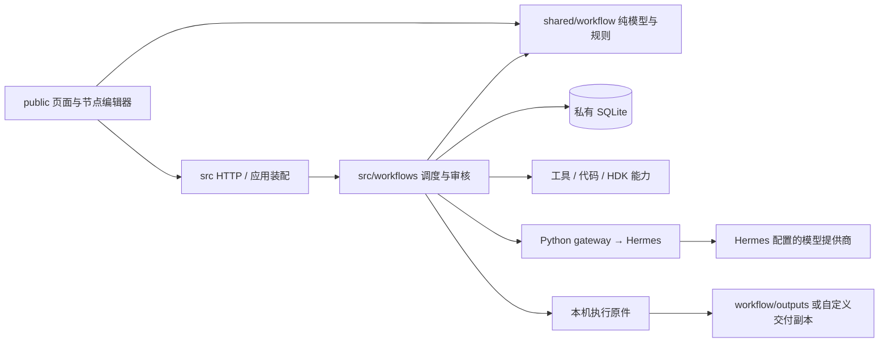

# 应用架构与目录边界

界面文案保留控件、字段必要含义、真实状态与错误，不常驻渲染助手能力介绍和重复操作教学。

顶部工具条的图标、悬停名称与无障碍名称统一更新；运行、学习等动态状态保持原有禁用条件和动作处理。

## 运行链路

当前 schema2 使用 DAG 依赖调度：独立分支可并行，汇总等待真实依赖，循环通过有界控制节点和子流程表达；schema1 仅保留旧线性链兼容。页面位置与节点数组顺序不决定执行顺序。

顶部提示横幅的显示与关闭由 `public/app.js` 管理；关闭只清除当前页面提示，不调用后端或改变连接、运行状态，后续通知可重新显示。

## 模块内聚与依赖方向

| 边界 | 职责 | 不负责 |
| --- | --- | --- |
| `src/application.mjs`、`server.mjs` | 装配服务、会话、HTTP/SSE 和请求校验 | DOM、硬件决策 |
| `src/config.mjs`、`workspace-layout.mjs` | 路径配置、工作环境初始化、一次性偏好兼容 | 搬移历史产物或改写审核 |
| `src/hermes-models.mjs`、`python/hermes_models.py` | Hermes 受限模型目录、原生全局选择与保存、严格读回确认 | 本地模型覆盖、认证文件或独立回退配置 |
| `shared/workflow/workflow-capability-contract.mjs`、`src/application-capabilities.mjs` | 共享真实能力契约、当前可用性、节点与运行时说明 | 以提示词代替处理器、虚构依赖就绪或扩大执行权限 |
| `src/workflows/` | 计划执行、文件、审核、对话提案、定时与学习编排 | 前端布局、直接替用户批准图片 |
| `shared/workflow/` | 纯模型、端口、规划、校验、数据集、时间及协议 | Node/DOM、数据库、网络或文件副作用 |
| `public/` | 页面、画布、输入表单和交互状态 | 可信授权、伪造服务端运行状态 |
| `python/` | Hermes JSON-RPC、Skill 冻结、学习记忆 scope、代码 worker | 工作流业务编排 |
| `hdk/` | EDA／图像／文档／固件的固定工具与强校验 | 猜硬件事实、伪造实测成功 |
| `skills/` | 维护中的细粒度能力指令、模板和资源 | 本地训练答案、候选或运行快照 |

共享模块既供 Node 导入，也以精确白名单 URL 提供给浏览器。静态服务不允许访问整个仓库。模块移动修正真实入口和 worker 路径，不保留无意义的旧转发文件。

## Hermes 与模型选择

聊天和 Skill 运行需要预先独立安装、配置并验证正常对话的 Hermes；工作台不会代为安装。当前核验版本为 Hermes 0.21.4，其它版本须确认 gateway 与原生模型选择接口兼容。安装入口及配置步骤见 [使用说明](user-guide.md#启动)。

Hermes 统一管理模型、提供商、认证、端点与 fallback。顶部入口读取已配置的模型目录，通过 Hermes 原生 `switch_model(is_global=true)` 和 `persist_model_selection` 更新全局默认选择；提供商须明确 `authenticated=true`，手动输入的模型 ID 也必须由 Hermes 确认。需要费用或数据策略等确认的选择转到 Hermes 原生界面处理，保存结果和重新读取的目录必须完全匹配才报告成功。浏览器仅接收必要标识和认证状态，不接收凭据、端点等配置。

主提供商与模型按会话、工作流运行和学习批次固定，运行内后续节点、修改尝试、子流程及学习控制调用沿用该选择；切换默认值只影响后续创建。`WORKBENCH_HERMES_MODEL` 和旧本地 `defaultModel` 不再覆盖 Hermes。工作台保留 `manual` / `smart` 审批要求，认证及 fallback 由 Hermes 自身配置决定。

旧运行或学习批次缺少主模型时，可从关联会话确认唯一选择后补回；无法确认则停止继续模型步骤并保留产物与审核，不套用当前默认模型。未记录模型的旧空会话拒绝重建。

## 工作环境与数据所有权

- 项目根目录 `workflow/` 是默认 cwd，启动时创建 `artifacts/`、`outputs/`。默认相对目录 `.` 直接指向该根。
- `workbench/.local/` 保留现有 SQLite、依赖和私有快照；旧 `workspaces/` 保留原路径，确保旧运行和 SHA 引用可读。显式配置优先。
- 新运行原件位于本机应用数据目录，节点回执、预览、输入输出与审核哈希绑定原件。用户输出目录只接收独立且经过 SHA 校验的交付副本。
- 交付失败可单独重试；副本变化生成新交付修订。复制不会触发节点或模型重跑。
- 现代 DAG 的交付范围由已完成输出节点明确声明的文件及节点自身保存结果决定；继承的产物索引只用于核对，不作为整批复制清单。每份成果须匹配本次生产节点的当前尝试、登记 SHA 与大小，复制前后复核；编译依赖、历史版本和未声明中间文件保留在原件目录。
- 显式资料包按同一生产节点登记的包清单展开，成员受清单 SHA、相对路径、大小和当前版本约束，不能借包清单复制运行根或其它目录。子流程对外声明的成果先核验、归集至父节点当前尝试，再以父运行文件引用继续传递，保留原始来源。
- `workflow/`、旧状态、私人 HDK 配置／训练记录和验证截图均由 Git 忽略；只有源码模板、通用示例与脱敏 fixture 可发布。

不能把代码目录整理当作移动历史数据库、修改已完成结果或重新批准产物的理由。

## 执行与人工审核

每次运行冻结流程、输入、来源哈希和 Skill 指纹。工具返回可读回的产物引用，执行器管理节点输入、输出、状态、尝试版本与日志。成功要求收到明确完成状态并通过实际文件／内容校验；断线与结果不明不会自动重放副作用。

人工审核可位于中途，阻塞相关下游，同时保留独立分支结果。图片生成后先保存并展示；“要求修改”仅返回明确指定的上游能力。用户批准的版本与 SHA 不因刷新、重试副本或代码整理而改变。

## 全局对话管理

工作流会话以工作流 ID 为边界；总控按问题建立独立主题，各自保存历史、待处理事项、诊断进度及操作回执。总控对话仅在管理页出现，看板和设置等页面不会追加到同一共享上下文。原 `global-application` 聊天继续作为历史会话访问，既有工作流、普通任务和会话正文保持原样。

会话目录是已有工作流与会话记录的只读投影，包含尚无消息的工作流，不为展示目录创建空会话。管理页先展示有界摘要；总控按需读取目标会话或提交只读诊断委派。子助手沿用目标工作流权限，委派不会继承总控的跨工作流权限，也不会执行运行、审核、学习或应用流程修改。

会话身份贯穿消息幂等、回复／重试关联、检查点、并发控制、事件投递及界面状态。跨主题的事项和迟到响应不能替换当前会话，主题切换不清除原记录。旧项目路由保留兼容入口，普通任务仍通过历史任务入口查看。

## 对话与学习

对话首先形成可审阅的节点修改提案，由界面应用到草稿；运行需要独立动作。回复节点／产物绑定所选运行和具体尝试，过期回复会被拒绝。

对话默认自动判断意图；明确运行请求复用原运行入口、预检和不确定提交保护，修改提案不会自动执行。反馈入口复用当前对话并捕获运行／尝试身份，合格对象不唯一时返回选择步骤。没有反馈学习前置条件时先返回可解释的准备状态，不生成不可执行的学习卡片；执行与学习的版本和范围检查继续由后端负责。

待处理状态由共享会话事项模型只读投影：明确关联的成功重试可接续旧聊天失败，旧审核卡依据真实运行与尝试状态收敛。投影不回写旧消息或运行，未知状态保留。折叠偏好属于界面；手动结束聊天关注不改变审核或业务状态。详见 [待处理事项](workflow-conversation.md#待处理事项)。

固定任务输入集中在共享输入模型解析：入口 `defaultValue`（兼容旧 `value`）只在本次输入缺失或空白时采用，显式值不被默认值覆盖。界面、预检、调度及执行共用解析，不在对话层新增独立模型或执行路径。画布显隐属于界面偏好，隐藏只影响可见性，不修改用户的节点库／属性展开偏好或工作流定义。

执行模式固定 Skill，允许 Hermes 按既有机制更新普通记忆。学习模式冻结批次只读记忆，区分训练与验证：评价器可读取对应答案，优化器只能取得训练反馈，不能通过 memory 回流验证输入／结果。候选正文与来源指纹、父版本和批次关联，不修改原 Hermes Skill。

只修改显式授权的 Skill 正文，不自动改代码、原始事实、验收规则或生产产物。完整协议见 [学习协议](learning-protocol.md)；连接、身份和会话完成语义见 [Hermes 协议](hermes-protocol.md)。

## 维护与验证

- 自动化测试统一在 `test/`；Python 测试与 fixture 也集中于此。
- 一次性绑定个人案例的旧工作流生成器已删除；实际业务图从编辑器搭建。
- 仍被当前能力调用的旧 Python 实现保留；旧 schema1 放行证据不因重构自动更新。
- 发布前运行 `npm --prefix workbench test` 和 `npm --prefix workbench run check:git`。纯源码包的测试不能隐式依赖私人训练答案或本机板卡资料。

## 应用诊断

`application-assistant.mjs` 在现有对话之下调度有界工具，`app-diagnostics.mjs` 只投影业务证据，`app-diagnostic-browser.mjs` 负责隔离浏览器取证。应用助手模型与学习评估使用独立托管会话、策略 RPC 与归属表；Hermes 原生工具保持关闭，应用能力由 Node 白名单执行。旧历史直接只读查询，不恢复任务。浏览器代理限制同源只读访问，图像以真实关键帧传给 Hermes。详细工具和边界见 [应用诊断](application-diagnostics.md)。

对话入口在服务端绑定独立工作流或总控身份，工具目录与 dispatcher 共用角色、对象归属及目录准入。独立会话固定工作流与工作文件夹，总控按人工配置开放跨工作流管理和软件日志；模型提供的 ID 不改变身份。“设置 → 助手权限”通过独立的版本化设置接口保存，助手工具和未来 MCP 均没有修改入口。权限变更逐次校验，旧检查点不提升权限；具体规则见 [会话权限与人工设置](application-assistant-capabilities.md#会话权限与人工设置)。

能力目录将产品支持、当前依赖与操作权限分开投影；`app.capabilities`、`node.describe` 和 `runtime.inspect` 让助手通过真实接口获取能力，而不是依赖提示词记住全部说明。内部 Skill 由注册表发现、按需加载，只解释和组合已有能力。共享合约保持无副作用，Node 后端负责实际探测和工具调度；前端、规划器与助手引用同一契约。

助手先发送紧凑证据，再按需读取详情；独立只读检查可经整批验证后顺序执行，同轮重复请求复用已完成结果。阶段、耗时和脱敏证据检查点增量保存在当前对话事项中，失败与重启保留诊断进度。跨轮复用校验业务上下文、模型路由、能力版本、工具契约与采集时间；它不恢复执行会话，也不重放提案或业务操作。单次模型硬截止与整轮预算分别限制等待，方案调用异常结束本轮。详细策略见 [上下文、进度与中断](application-diagnostics.md#上下文进度与中断)。

新增或变更用户功能时，同步修改能力目录、受影响的工具 schema／dispatch、必要说明与同接口回归。业务代码候选进入现有工作流提案、应用、执行及产物链；源码写保护不被候选路径绕过，代码进程也不构成 OS 沙箱。新增写操作显式约束对象、版本、幂等和读回验证。具体维护步骤见 [能力维护指南](application-assistant-capabilities.md)。

目前没有对外 MCP server。后续 MCP 适配器复用上述 schema、dispatcher 和校验，仅承担协议转换，不复制另一套权限实现。
